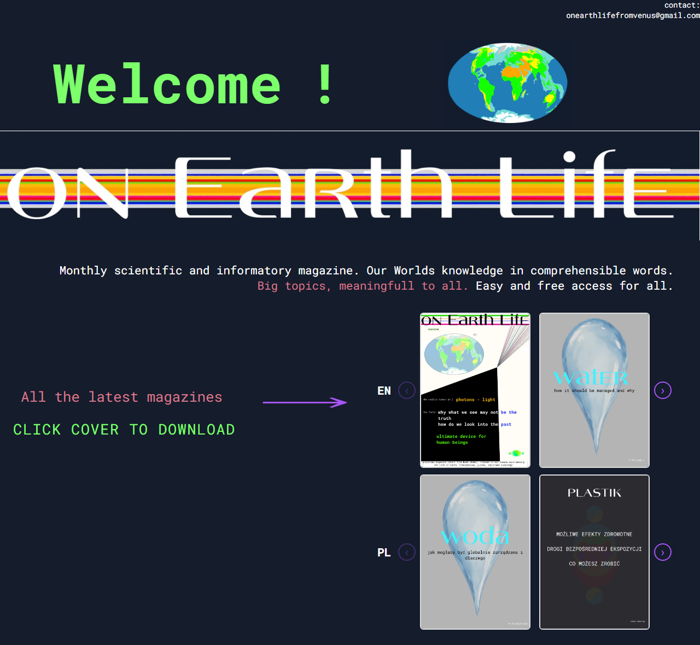

# On Earth Life

A free, bilingual (English / Polish) science magazine, and the website that publishes it.

**Live site:** <https://www.oelfvmag.com>



## About

*On Earth Life* is a monthly science and information magazine. It explains big
topics in plain language, and every issue is free to read and download.

This repository contains the website. Readers browse the latest covers in English
and Polish, click one to see it larger, and download the PDF. New issues go live
automatically when they are pushed to `main`.

## Features

- **Two cover carousels**, one for English issues and one for Polish, with arrow
  buttons that switch off at either end
- **Lightbox preview**: click a cover to see it larger and download the issue as a PDF.
  Close it with ×, by clicking outside it, or with <kbd>Esc</kbd>
- **Responsive layout** with a separate mobile design below 768 px
- **Continuous deployment**: every push to `main` builds the site and deploys it to
  the production server

## Tech stack

| Area       | Tools                                                     |
| ---------- | --------------------------------------------------------- |
| Language   | TypeScript (strict mode), no framework                    |
| Build      | [Vite](https://vite.dev)                                  |
| Styling    | Plain CSS, [Roboto Mono](https://fonts.google.com/specimen/Roboto+Mono) |
| Hosting    | nginx on a Linux VPS, HTTPS                               |
| CI/CD      | GitHub Actions, deploying over SSH                        |

## Project structure

```text
index.html                  Page markup, including the cover carousels
script.ts                   Lightbox and carousel behaviour
styles.css                  All styles, including the mobile layout
static/files/               Magazine PDFs and their cover images
static/img/                 Site artwork (banner, planet)
.github/workflows/deploy.yml  Build-and-deploy pipeline
```

## Running locally

You need [Node.js](https://nodejs.org) 20 or newer.

```bash
npm ci
npm run dev
```

Vite prints a local address, usually <http://localhost:5173>.

To make a production build in `dist/`:

```bash
npm run build
```

> **Note:** The PDF links live in `data-pdf` attributes, and Vite doesn't process
> those, so the PDFs are not copied into `dist/`. The deploy workflow uploads
> `static/files/` separately. As a result, PDF downloads work in `npm run dev`
> but not in `npm run preview`.

## Adding a new issue

1. Put the PDF and its cover image in `static/files/`.
2. In `index.html`, add a block at the start of the right carousel
   (`imageRowEng` for English, `imageRowPl` for Polish). The newest issue goes first:

   ```html
   <div class="cover-wrap">
       " alt="<Issue title> cover" data-pdf="static/files/<issue>.pdf">
   </div>
   ```

3. Commit and push to `main`. GitHub Actions builds and deploys the site.

## Deployment

On every push to `main`, [`deploy.yml`](.github/workflows/deploy.yml):

1. installs dependencies and runs `vite build`
2. copies `dist/` and `static/files/` to `/var/www/html` on the server over SSH
3. gives the files back to the web server user (`www-data`)

The workflow needs three repository secrets:

| Secret     | Value                                |
| ---------- | ------------------------------------ |
| `SSH_KEY`  | Private key of the deploy user       |
| `SSH_HOST` | Server hostname or IP                |
| `SSH_USER` | Deploy user on the server            |

## Contact

onearthlifefromvenus@gmail.com

## License

- **Code** (HTML, CSS, TypeScript, configuration): [MIT](LICENSE)
- **Magazine issues and artwork** (`static/files/`, `static/img/`):
  © Aeria Tellar, licensed under [CC BY-NC-ND 4.0](static/LICENSE.md). You can
  share them freely with credit, but you can't sell them or share edited versions.
